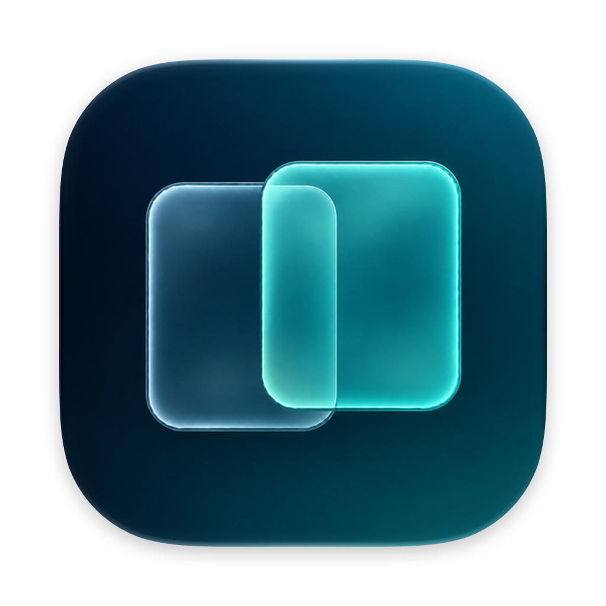
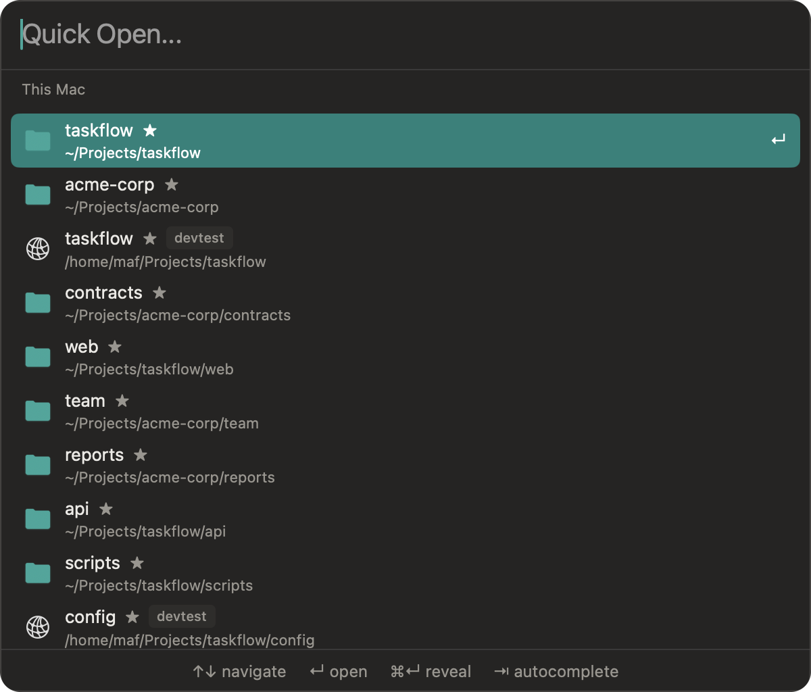
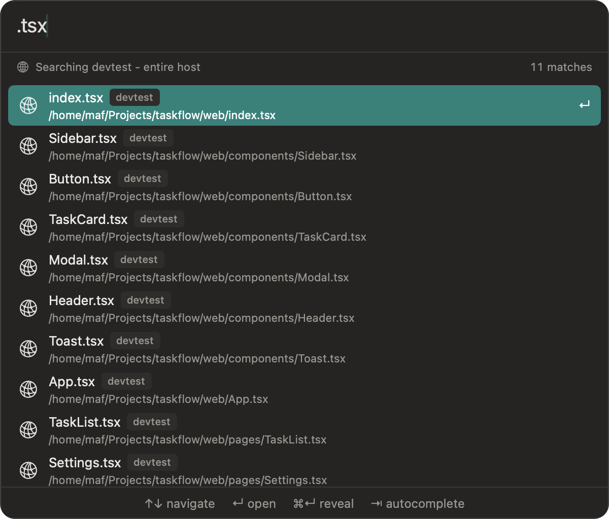
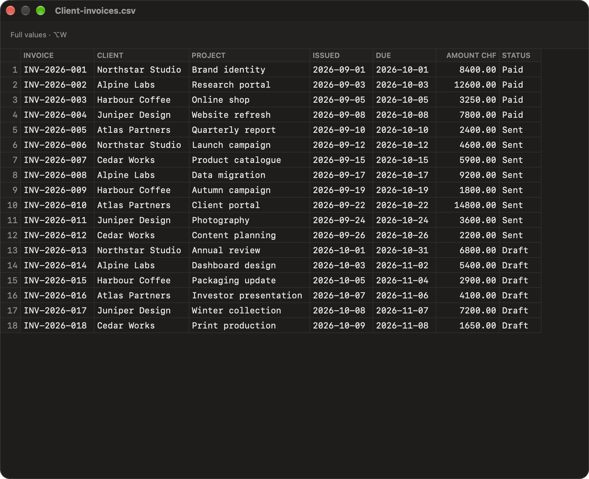
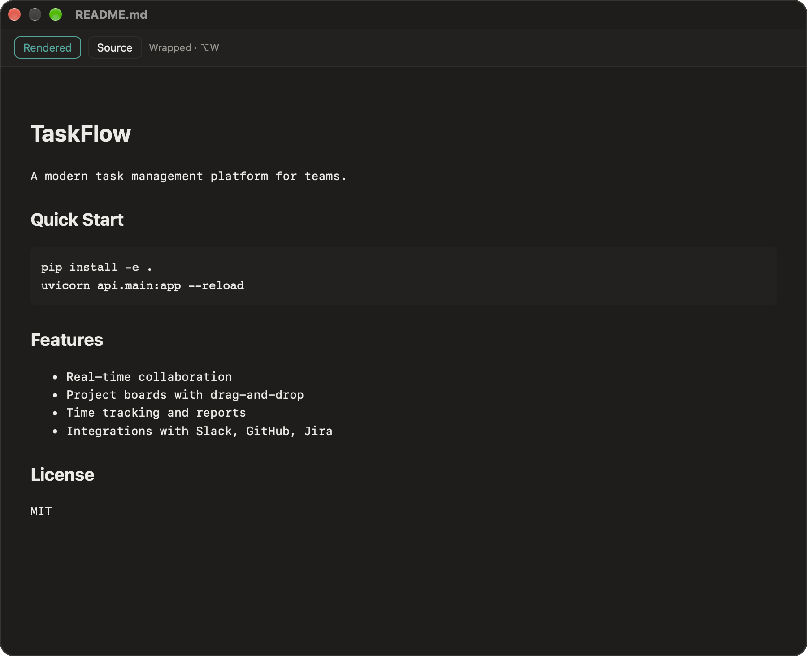
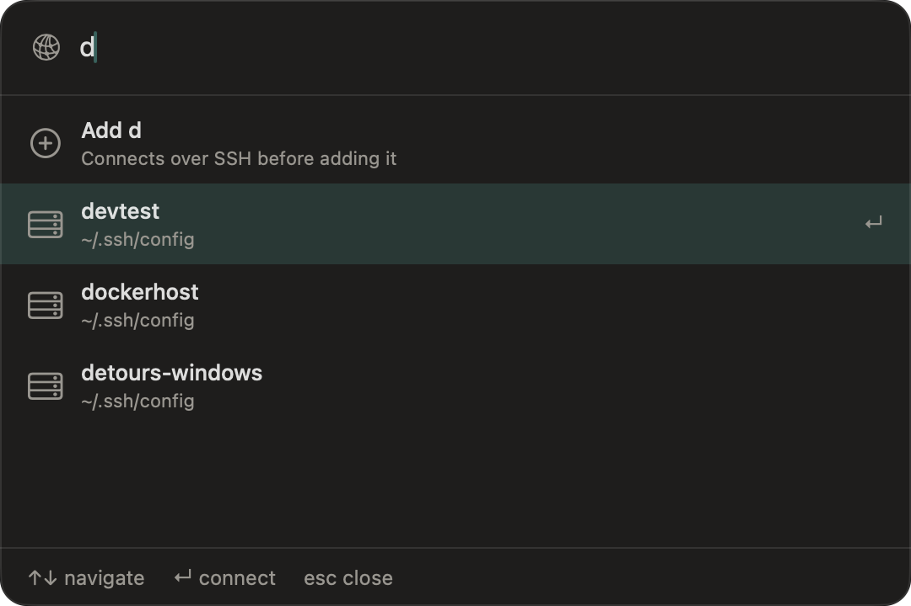

<p align="center">
  
</p>

<h1 align="center">Detours</h1>

<h3 align="center">Find it. Preview it. Get on with your work.</h3>

<p align="center">A native, keyboard-driven Mac file manager.<br>Navigate, inspect and organise your files without losing your place.</p>

<p align="center">
  <a href="https://github.com/detours-app/detours/releases/latest"><strong>Download for macOS</strong></a> ·
  <a href="https://detours-app.github.io/detours/USER_GUIDE.html">User guide</a> ·
  <a href="https://github.com/detours-app/detours/releases">What's new</a>
  <br>
  <sub>Free and open source · macOS 14 Sonoma or later</sub>
</p>


## Keep your work in view

Keep a source and destination side by side, with tabs in each pane for the places you return to. Expand folders in the list instead of opening them one by one. Filter by name when a folder gets busy. Your tabs, selections and expanded folders return when you reopen Detours.

Press **Tab** to change panes, **F5** to copy or **F6** to move. Detours selects and reveals the result, so you can carry on from the file you just worked on.

## Cmd-P. Straight to the file.

Open Quick Open to return to recently and frequently visited folders, including places on connected servers. Stars mark those familiar places; host badges distinguish remote locations from folders on your Mac.

<p align="center"></p>

Start typing to find a file or folder. A local tab searches your Mac; a remote tab searches its host, with that host's recent places kept above the matching files.

<p align="center"></p>

## Space. See what's inside.

Check the contents before opening another app. CSV and TSV files become readable tables. Code gets syntax highlighting. Markdown and HTML have rendered and source views. Images, Word (.docx) documents and Excel (.xlsx) spreadsheets have previews too, including files on supported remote hosts.



<p align="center"><sub>A CSV you can read as a table, with column headings and row numbers.</sub></p>



<p align="center"><sub>Read the README without opening an editor. Switch to Source when you need the markup.</sub></p>

Word and Excel previews are for inspection, not editing; spreadsheets show the first visible worksheet. See the [preview guide](https://detours-app.github.io/detours/USER_GUIDE.html#previews-space) for supported formats and limits.

## Pack it. Encrypt it. Send it.

Create and extract **ZIP, 7Z, TAR.GZ, TAR.BZ2 and TAR.XZ** archives directly from your file list. Select the files, choose Archive, and pick a format. No separate archive app to switch to.

Password-protect ZIP and 7Z archives. **Encrypted 7Z also hides the filenames** inside, not just the contents. For stronger encryption on your Mac, choose 7Z: local ZIP uses legacy password protection, not AES-256.

Some formats require installed command-line tools. See the [archive guide](https://detours-app.github.io/detours/USER_GUIDE.html#archives-and-encryption) for encryption details and remote-host limits.

## The details that make file work easier

- **Undo per tab.** Copy, move, rename and Trash have undo, including supported remote operations. Each tab keeps its own history.
- **Git status where the files are.** Recognise modified, staged, untracked and conflicted files by distinct markers, in local and remote repositories.
- **Repeat the structure, not the contents.** Duplicate a folder hierarchy without its files, with optional year substitution for the next project or reporting period.
- **Keep small jobs moving.** Rename a file or create a folder elsewhere while an unrelated large local copy runs. Progress and transfer speed stay visible in the status bar.

## Cmd-K. Bring your servers into the picture.

Choose an SSH target from your existing configuration or type one in. Connect to a [supported Mac, Linux or Windows host](https://detours-app.github.io/detours/USER_GUIDE.html#supported-remote-hosts) without mounting it as a volume.

<p align="center"></p>

Use familiar tabs, folder expansion, previews, Git markers and file operations on the other machine. Copy between your Mac and a server, or between servers. Open remote files in an editor and send saved changes back.

If a connection drops, Remote Operations keeps a record of what finished and what still needs checking, even after you close the tab. [Remote workflows and limits](https://detours-app.github.io/detours/USER_GUIDE.html#remote-hosts) are documented in the guide.

## At home on your Mac

Share local files through AirDrop and macOS sharing services. Browse iCloud and network shares. Drag files to Finder and other apps. Choose light, dark or system appearance, adjust the row density and font size, and turn stripes on or off.

Built with AppKit and SwiftUI. No account or subscription.

## Install

Download the DMG from the [latest release](https://github.com/detours-app/detours/releases/latest), open it, and drag Detours to Applications.

<details>
<summary>Keyboard shortcuts</summary>

| Action | Shortcut |
| --- | --- |
| Quick Open | Cmd-P |
| Add remote host | Cmd-K |
| Preview | Space |
| Switch pane | Tab |
| New tab | Cmd-T |
| Go up a folder | Cmd-Up |
| Filter this folder | Cmd-F |
| Copy / move to the other pane | F5 / F6 |
| Rename | F2 / Shift-Enter |
| New folder | Cmd-Shift-N |
| Move to Trash | Cmd-Delete |
| Undo | Cmd-Z |

Remap supported actions in Preferences. See the [full shortcut reference](https://detours-app.github.io/detours/USER_GUIDE.html#keyboard-shortcuts-reference).

</details>

<details>
<summary>Building from source</summary>

Requires Swift 6.2+, full Xcode for asset compilation, and a code-signing identity. The build script also bundles remote helpers. When the Linux helper cache is missing or stale, it rebuilds through an SSH host named `devtest` with Docker available.

```bash
git clone https://github.com/detours-app/detours.git
cd detours
./resources/scripts/build.sh --no-install
```

Use the build script so the app is packaged and signed correctly. Run it without `--no-install` to install to Applications and relaunch Detours.

</details>

## Feedback and license

[Report a bug or suggest a feature](https://github.com/detours-app/detours/issues). Licensed under [MIT](LICENSE).
