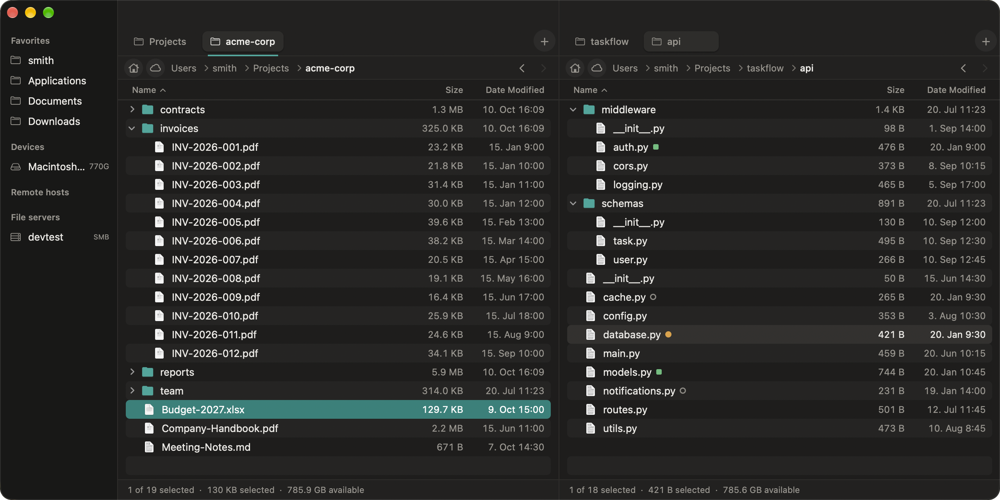

# Detours User Guide

A fast, keyboard-driven file manager for macOS with dual-pane layout.

---

## Interface Overview

Detours shows two file panes side-by-side, each with independent tabs. One pane is always "active" (indicated by the accent-colored tab underline). The active pane receives keyboard input.



### Panes

- **Switch pane**: Press `Tab` (without modifiers)
- **Active pane**: Has accent-colored underline on selected tab
- **Inactive pane**: No underline; its selection turns grey

### Tabs

Each pane can have multiple tabs, each showing a different directory:

| Action | Shortcut |
| ------ | -------- |
| New tab | Cmd-T |
| Close tab | Cmd-W |
| Next tab | Ctrl-Tab |
| Previous tab | Ctrl-Shift-Tab |
| Select tab 1-9 | Cmd-1 through Cmd-9 |
| Open folder in new tab | Cmd-Shift-Down |

Tabs can be reordered by dragging, and moved between panes by dragging to the other pane's tab bar.

### Path Bar

Below the tabs, the path bar shows:

- **Back and Forward buttons**: Go back and forward in the tab's history
- **Home button**: Go to home directory
- **iCloud button**: Go to iCloud Drive
- **Path**: Click any segment to navigate; the current folder is shown in a heavier weight

**Path bar tips:**

- Click a segment to navigate there
- Drag a segment to terminal or another app to insert the path
- Right-click a segment to copy its path

### Status Bar

One line at the bottom of each pane (toggle with View menu):

- Host name, for a remote pane
- Item count and selection count
- Size of selected items
- Hidden file count (if any hidden)
- Available disk space
- While a file operation runs, its progress, transfer speed, completion and error states appear at the right end

### Sidebar

The sidebar shows remote hosts, mounted volumes, network shares, and favorite folders:

| Action | How |
| ------ | -------- |
| Navigate to item | Click it |
| Add favorite | Drag folder from file list |
| Reorder favorites | Drag to new position |
| Remove favorite | Right-click → Remove from Favorites |
| Eject volume | Right-click → Eject, or click eject button |
| Add SSH remote host | File → Add Remote Host... (Cmd-K) |
| Connect to network share | File → Connect to Network Share... |
| Toggle sidebar | Cmd-0 |

**Remote hosts:** The sidebar has a dedicated Remote hosts section for SSH targets added in Detours. Selecting a connected host opens that host in the active pane. Unreachable hosts remain visible with a reconnect state.

**Network shares:** The sidebar has a dedicated File servers section showing servers discovered via Bonjour. Servers group their mounted volumes underneath. Offline servers appear dimmed. Use File → Connect to Network Share... to connect to a server manually (SMB/AFP). Connecting runs in the background, so the window stays usable while the server answers, and a failed attempt shows one message. When a sidebar server asks for a name and password, macOS shows its share picker after the login so you can choose the share to mount.

---

## Navigation

### Keyboard Navigation

| Action | Shortcut |
| ------ | -------- |
| Move selection | Arrow keys |
| Move one page | Page Up/Page Down |
| Extend selection one page | Shift-Page Up/Shift-Page Down |
| Open selected items or focused folder | Enter, Cmd-O, or Cmd-Down |
| Go to parent folder | Cmd-Up |
| Go back | Cmd-Left |
| Go forward | Cmd-Right |
| Type-to-select | Start typing filename |
| Refresh | Cmd-R |

### Quick Open (Cmd-P)

Quick Open follows the active tab:

- Local tabs search the Mac with Spotlight plus Detours' active-pane folder search.
- Remote tabs search the active SSH host by file and folder name through the Detours helper on macOS and Linux, or PowerShell on Windows.
- Disconnected remote tabs show a Reconnect action instead of silently searching the Mac.

1. Press **Cmd-P** to open
2. Type to search (substring matching)
3. Press **Enter** to navigate to selected folder
4. Press **Cmd-Enter** to reveal file's enclosing folder

Results are ranked by "frecency" - frequently and recently visited directories appear first (marked with a star).

**Tip:** Quick Open searches the whole Mac through Spotlight. Enable "Include hidden files in Quick Open" in Preferences to also search hidden files.

Remote Quick Open keeps recent places scoped to the active host and searches names case-insensitively. On macOS and Linux helper hosts, it searches the remote home folder and `/opt` first, then the rest of the host with hidden folders, `node_modules`, pseudo filesystems and external mounts left out, and streams results as the helper finds them. On Windows hosts, it searches from the active folder through the PowerShell backend.

### Selection

| Action | Shortcut |
| ------ | -------- |
| Select item | Click or arrow keys |
| Extend selection | Shift-Up/Down |
| Select all | Cmd-A |
| Clear multi-selection | Click empty space |

Open acts on every selected ordinary file in the order shown. Folders, archives, and disk images in a mixed selection remain untouched. When the selection has no ordinary files, Open keeps the focused item's normal behavior, such as entering a folder, extracting an archive, or mounting a disk image. Opening more than five ordinary files requires confirmation first.

---

## File Operations

### Basic Operations

| Action | Shortcut |
| ------ | -------- |
| Copy | Cmd-C |
| Cut | Cmd-X |
| Paste | Cmd-V |
| Duplicate | Cmd-D |
| Duplicate Structure | Right-click folder → Duplicate Structure... |
| Rename | F2 or Shift-Enter |
| Move to Trash | Cmd-Delete or F8 |
| Delete Immediately | Cmd-Option-Delete |
| New Folder | Cmd-Shift-N or F7 |
| New Text File | Cmd-Option-N |

The File menu and context menu also include New File choices for Text File, Markdown File, and Empty File.

The inline Rename field grows as you type or paste a longer name, up to the visible edge of the Name column.

A new folder or file starts as "Folder" or "Text File", or the next free number when that name is in use. If the name you type is already taken, Detours says so and returns you to the name field; type another name, or press Escape to discard the new item.

**Duplicate Structure** creates a copy of a folder's entire directory hierarchy without copying files. Ideal for year-based folder templates (e.g., `Clients/2025/` → `Clients/2026/`). Auto-detects years in folder names and offers to substitute them.

### Cross-Pane Operations

Move or copy files directly to the other pane:

| Action | Shortcut |
| ------ | -------- |
| Copy to other pane | F5 |
| Move to other pane | F6 |

After the operation, the moved/copied files are automatically selected in the destination pane.

If the destination is a deliberately selected closed folder, a completed F5 copy opens that folder and reveals the copied item. Paste also uses exactly one deliberately selected folder; automatic or multiple-folder selections paste into the directory shown by the tab.

Cross-pane copy and move work between local panes, a local pane and a remote pane, and remote panes. Transfers that cross providers are staged through Detours' operation queue with progress and cancellation.

**Symbolic links** follow one rule. Within one machine, a copied link stays a link with the same target, and a moved link is renamed without touching what it points at. Across machines, a selected link travels as the file or folder it points at, under the link's name, and a chain of links is followed to its end. Inside a folder copied across machines, a link pointing within that folder arrives as a link adjusted to the copied counterpart, while a link pointing outside arrives as a copy of what it points at. A link whose target is missing, or one that leads back into a folder already being copied, fails that one item with a message naming the link; the other items still copy, and a moved folder with such a failure stays whole at the source. Trashing a link removes the link and leaves its target in place, on the Mac and on remote hosts.

### Operation Progress

Longer file operations show progress directly in both pane status bars. Progress includes the operation state, item counts, byte counts when available, transfer speed, completion messages, and errors.

Small independent operations such as rename, new file, new folder, move to Trash, and small copies can run while unrelated large operations continue in the background.

An item a running copy is still writing cannot be renamed; Detours refuses with a message to wait for the copy to finish, so a half-written folder is never moved out from under the copy. The system log records which operation holds the path, for the case where the refusal is unexpected.

### Other Actions

| Action | Shortcut |
| ------ | -------- |
| Quick Look preview | Space |
| Get Info | Cmd-I |
| Copy Path | Cmd-Option-C |
| Open in Editor | F4 (opens in TextEdit) |
| Reveal in Finder | File menu → Reveal in Finder |
| Show Package Contents | File menu (for .app bundles etc.) |

Copy Path puts the selected paths on the clipboard wrapped in single quotes, one per line, so they paste into a terminal as they are whatever characters the names contain. The path bar's right-click Copy Path does the same for that folder.

On remote selections, Get Info opens a Detours info window with host, path, kind, size, modified date, hidden/readable state, and symlink target when applicable. Reveal in Finder and Share are local-only because Finder and macOS sharing services require local files.

Quick Look opens supported text, data, document and image files in a themed Detours preview window. A file whose contents are text previews as text whatever its name ends in, including UTF-16 files such as Windows registry exports; source files and security assessment files such as nmap output, Nessus reports, certificates and wordlists are shown with syntax colouring. PDF, SVG and RTF go to the macOS preview. PDFs open in the system Quick Look panel, which offers page thumbnails and page-by-page navigation. Markdown and HTML previews have Rendered and Source views. Comma, semicolon and tab separated data files and Excel workbooks show as tables with the column names and row numbers held in place while scrolling; Word documents show their headings, lists and tables in the active theme. Rendered HTML keeps inline styling and self-contained images but removes scripts, forms, navigation, external resources, and other active content. Long lines wrap by default; use View > Wrap Lines in Preview (`Option-W`) to change the current source preview. In a table that same setting switches between showing a value too wide for its column in full and trimming it to one line per row, and the toolbar names whichever it is doing. View > Open in System Preview (`Option-P`) hands the file you are looking at to the macOS panel, for the times its viewer suits the file better; it applies to that file, and moving to another previews it the usual way again. Unsupported files use the system Quick Look panel. Remote previews download into the same Detours window and are limited to 100 MB. A symbolic link previews the file it points at, under that file's name; a link to a folder closes the preview, as selecting a folder does.

### Archives

Create and extract archives directly from the file list.

| Action | Shortcut |
| ------ | -------- |
| Archive selected items | Cmd-Shift-A |
| Extract archive | Cmd-Shift-E or double-click |

**Creating archives:**

- Select files/folders, then File > Archive... (or right-click > Archive...)
- Five formats: ZIP, 7Z, TAR.GZ, TAR.BZ2, TAR.XZ
- Formats requiring external tools (7z, xz, bzip2) are shown dimmed if not installed
- ZIP and 7Z offer **Encrypt with password**. TAR formats do not support passwords.
- ZIP passwords may contain up to 80 UTF-8 bytes. 7Z passwords do not have this Detours limit.
- Last-used format is remembered between sessions

**Extracting archives:**

- Select an archive, then File > Extract Here (or right-click > Extract Here, or double-click)
- ZIP and 7Z archives ask for a password when needed. An incorrect password opens another prompt and leaves no partial extracted items.
- ZIP passwords longer than 80 UTF-8 bytes remain in the prompt with a validation message and do not start extraction.
- Conflict dialog when extracting over existing items (Skip/Replace/Keep Both)

Archive and Extract Here work locally and on supported remote hosts. Password-protected ZIP and 7Z work locally and through the bundled helper on supported macOS and Linux hosts. Windows remote hosts support unencrypted archives only and can always create and extract unencrypted ZIP archives through the built-in PowerShell backend. Available formats otherwise depend on the tools installed on the Mac or remote host.

Encrypted ZIP archives use AES-256. Encrypted 7Z archives also encrypt the archive headers so filenames are hidden. Detours sends archive passwords only through a terminal prompt and never puts them in the archive tool's command-line arguments, progress text, or error text. This protects the password from ordinary process-list inspection but does not protect caller-owned memory from privileged inspection.

### Share

Share files via AirDrop and other system sharing services:

- File > Share (or right-click > Share)
- AirDrop is listed first for quick access
- Available sharing services depend on the selected file types

### Disk Images

Opening `.dmg`, `.sparsebundle`, `.sparseimage`, or `.iso` files (via Cmd-P, double-click, or Enter) mounts them and navigates the pane to the mounted volume. For encrypted disk images, the pane navigates after the password dialog completes.

### Conflict Resolution

When pasting files that already exist at the destination, a dialog offers:

- **Skip**: Don't copy this file
- **Replace**: Overwrite existing file
- **Keep Both**: Rename the new file (adds number suffix)

### Undo and Redo

Most file operations can be undone with **Cmd-Z** and redone with **Cmd-Shift-Z**:

- Undo delete (restores from Trash), copy, move, duplicate, rename, and new folder/file
- Each tab has its own independent undo history
- Edit menu shows the operation name (e.g., "Undo Delete", "Undo Move")
- Delete Immediately cannot be undone

### Delete Immediately

**Cmd-Option-Delete** permanently deletes files without using the Trash. A confirmation dialog appears:

> "filename" will be deleted immediately. You can't undo this action.

Use with caution - this bypasses the Trash completely.

---

## Remote Hosts

Detours can browse supported remote machines directly over SSH without mounting SMB, NFS, sshfs, or a Finder-visible volume.

### Adding a Remote Host

1. Choose File → Add Remote Host... or press Cmd-K.
2. Enter an SSH target such as `build-linux`, `intel-mac`, or `user@example-host`.
3. Confirm the host. Detours connects with the system `/usr/bin/ssh`, using the same SSH config, known-hosts files, and agent as Terminal.

The Add Remote Host sheet suggests entries from `~/.ssh/config`. Adding a host saves it in the Remote hosts section and opens it in the active pane.

### Supported Remote Hosts

This release supports:

- x86_64 Linux
- Intel macOS (`Darwin x86_64`)
- Windows OpenSSH hosts whose default shell is Windows PowerShell

Apple Silicon macOS hosts, ARM Linux hosts, BSD hosts, embedded sshd targets, and Windows SSH hosts configured with a Unix-style default shell are unsupported.

### Remote Helper

On first connect to a supported macOS or Linux host, Detours installs a small helper:

```text
~/.detours-server/detours-server
```

The helper powers remote listings, file operations, folder sizes, git status, watching, Quick Open search, and transfers. Detours silently redeploys it when the bundled helper changes. Windows hosts use PowerShell over SSH instead and do not receive a helper binary.

### Remote File Workflows

Remote panes support normal Detours workflows:

- Browse folders, tabs, breadcrumbs, and folder expansion
- Copy, cut, paste, F5 copy-to-other-pane, and F6 move-to-other-pane across Mac and remote panes
- Symbolic links: kept as links within one host, carried as what they point at across hosts (see Cross-Pane Operations)
- Move to Trash and Undo restore
- New Folder and New File, with the same taken-name message as local folders
- Rename
- Get Info and Copy Path
- Quick Look and Open With round trips
- Drag files and folders within a remote host, across remote hosts, and between
  local and remote panes
- Drag remote files out to Finder or other apps
- Archive and Extract Here, with formats based on host tool availability
- Git status markers
- Automatic updates after external changes, replaced folders, reconnects, and transient listing failures

Current remote exceptions:

- Duplicate and Duplicate Structure are local-only because those commands still operate on local URL selections.
- Reveal in Finder and Share are local-only because Finder and macOS sharing services need local files. Use drag-out or Open With when you need a local materialized copy.
- Delete Immediately permanently removes remote items after the same explicit,
  non-recoverable confirmation used for local items.
- Windows remote hosts do not support password-protected archives. Supported macOS and Linux helper hosts support password-protected ZIP and 7Z without placing passwords in process arguments.
- Helper deployment accepts only x86_64 Linux and Intel macOS. Apple Silicon macOS, ARM Linux, BSD, and embedded sshd remotes are unsupported.

Large transfers use a second SSH channel so listings, git status, Quick Open search, and watch events can continue on the metadata channel. A transfer the host refuses fails with the host's own message and leaves nothing at the destination. Remote git status runs after the directory listing completes; a slow repository should not block the list refresh.

### Remote Operation Results

Detours shows a remote host as connected only once it can answer requests. While it reconnects, the last listing stays visible and is marked as possibly out of date, and the banner names the host. Recovery is bounded: attempts stop after a 60-second deadline from the first failure, and an authentication or compatibility failure stops automatic recovery. "Couldn't reconnect to {host}." means Reconnect is available; reconnecting checks unfinished work and never repeats a change.

Each remote change reports its own per-item result. Confirmed items, skipped items, known failures and unknown items are counted separately, and a confirmed item keeps its own Undo even when another item failed. Cancel asks the host to stop and then reports only what is known: "Cancelled. No files changed." once the files are confirmed untouched, a partial count when some items finished, or "Couldn't confirm whether '{item}' was {action} on {host}." when the outcome is unknown.

Window > Remote Operations lists every saved result independently of the open tabs. Open it to see the host, recorded source and destination, confirmed locations, retained originals and recovery locations, and to use Check Result (status and filesystem reads only) or Restore Original (returns a retained original to a free name). Details stay available after you navigate away, close a tab or complete later work, and Detours never repeats a change to resolve an unfinished one.

### Automatic Remote Updates

Remote listings update automatically. On supported macOS and Linux hosts, native notifications normally trigger a refresh after a 100 ms quiet period; a once-per-second check catches missed changes and in-place edits. Network and listing time add to that delay. Reconnects restore watches and reload visible folders, and transient failures retry automatically. Persistent errors use a compact banner above the list. See [Automatic Remote Updates](remote-vm-browsing.md#automatic-remote-updates) for timing and platform details.

An open remote tab keeps its connection active even when you are not interacting with it. This also applies to tabs restored when Detours starts, so the idle timeout does not silently stop their updates.

### Remote Trash

Remote deletes do not use the Mac Trash. On macOS and Linux hosts, Detours uses the remote user's FreeDesktop trash. On Windows hosts, it uses a Detours-managed `.detours-trash` folder in the user's profile. Undo restores items from the corresponding host-side trash using the recorded receipt, and never overwrites a name that is already occupied. The first remote delete shows an explainer; it is also available from Help → About Remote Trash.

---

## Filter-in-Place

Press `/` or `Cmd-F` to filter the current file list without leaving the directory.

- Case-insensitive substring matching filters in real-time as you type
- Auto-expands folders to reveal matching nested files
- Match count shows visible items (e.g., "12 of 347")
- Escape clears filter text; second press closes the filter bar
- Down arrow moves focus from filter field to file list

---

## Folder Expansion

Folders can be expanded inline to show their contents without navigating into them (like Finder's list view).

### Mouse

- Click the disclosure triangle (▶) to expand/collapse
- **Option-click** to expand/collapse recursively (all nested folders)

### Keyboard

| Action | Shortcut |
| ------ | -------- |
| Expand folder | Right Arrow (when folder selected) |
| Collapse folder | Left Arrow (when expanded folder selected) |
| Move to first child | Right Arrow (when already expanded) |
| Move to parent | Left Arrow (when collapsed or on child item) |
| Expand recursively | Option-Right |
| Collapse recursively | Option-Left |

### Behavior

- Expansion state is preserved per tab
- Expansion state persists across app restarts
- When collapsing a folder, if selection was inside it, selection moves to the folder
- Each pane's tabs have independent expansion states

### Disabling

To disable folder expansion (removes disclosure triangles), open Preferences → General and uncheck "Enable folder expansion".

---

## Git Status Indicators

When viewing a Git repository, a small mark after a file's name shows its git state. Each state has its own shape, so the marks can be told apart without colour:

| Mark | Status |
| ------ | -------- |
| Amber filled circle | Modified (changed since last commit) |
| Green filled rounded square | Staged (added to the index) |
| Grey hollow ring | Untracked (new file, not in git) |
| Red filled diamond | Conflict (merge conflict) |

Clean files have no mark. Hover over a mark to see its state; VoiceOver reads it as part of the file name. Git status indicators work for files inside expanded folders too.

### Configuration

Preferences → Git:

- Toggle git status indicators on/off
- A legend of the four marks

---

## Themes and Appearance

Detours uses calm warm-grey surfaces and keeps colour for meaning: the selection, the active pane, git marks, warnings and errors.

### Appearance

Preferences → Appearance offers **System**, **Light** and **Dark**. System follows macOS dark and light mode. The choice applies to the whole app at once, including right-click menus, alerts, Preferences and Quick Look. The menus in the menu bar follow macOS's own light or dark mode.

Earlier versions offered Foolscap, Drafting and a custom theme editor. Those are gone: Foolscap and Drafting open as Light, a custom theme opens as System, and every other preference is kept.

### Accent Colour

Selections, focus rings and the active tab's underline use the accent colour chosen in System Settings → Appearance. With **Multicolor**, Detours uses its own teal, the same teal as its app icon.

### Row Stripes

File lists have no stripes by default. Turn on **Row stripes** in Preferences → Appearance to shade every other file row.

### Dock Icon

Preferences → Appearance → **Dock icon** offers Default and **Deep sea**. Deep sea replaces the icon in the Dock and the app switcher while Detours runs. Finder, Launchpad and Spotlight always show the default icon, and the Dock shows it again after Detours quits.

### Date Formats

Customize how dates appear in the file list:

- **Current year format**: e.g., "d. MMM H:mm" → "21. Jan 14:30"
- **Other years format**: e.g., "d.M.yy" → "21.1.25"

Uses standard date format patterns (see Apple's date formatting guide).

---

## Preferences

Open with **Cmd-,** (or Detours menu → Preferences)

### General

- **Restore session on launch**: Reopen tabs from last session
- **Show hidden files by default**: New tabs show hidden files
- **Include hidden files in Quick Open**: Search includes hidden files
- **Enable folder expansion**: Show disclosure triangles
- **Folders on top**: List folders before files whatever the sort column
- **Wrap long lines**: Wrap long lines in Detours text previews

### Appearance

- Appearance: System, Light or Dark
- Font size
- File-list density: Compact, Comfortable, or Spacious
- Row stripes
- Date format customization
- Dock icon: Default or Deep sea

### Shortcuts

Customize keyboard shortcuts for 15 actions:

- Quick Look, Open in Editor
- Copy/Move to Other Pane
- New Folder, Delete to Trash, Delete Immediately, Rename
- Open in New Tab
- Toggle Hidden Files
- Quick Open, Filter, Refresh, Toggle Sidebar, Add Remote Host

Click a shortcut field and press your desired key combination. Click the reset button (↺) to restore the default.

### Git

- Enable/disable git status indicators

---

## Hidden Features

Features that aren't immediately obvious:

### Split Pane Divider

- **Drag** the divider between panes to resize
- **Equal-width indicator**: A brief accent-coloured line on the divider shows the moment the panes are equal width while dragging; it does not move the divider
- **Equalize panes**: Press Ctrl-Cmd-= or choose View → Equalize Panes

### iCloud Drive

- iCloud app folders show friendly names (e.g., "Pages" instead of "com~apple~Pages")
- Navigating into an iCloud app container automatically skips to its Documents subfolder
- iCloud root uses a Finder-like top-level list (Documents, Downloads, app folders, etc.)
- Top-level shared items are split into a dedicated `Shared` folder
- `Shared` shows one combined list for items shared to you and by you
- Shared labels show `Shared by <owner>` or `Shared by me`
- Hidden-files toggle applies to both iCloud root and `Shared` view
- A stray hidden flag left by an interrupted sync is cleared from anything Detours has just duplicated or renamed

### Packages

- .app bundles, .sparsebundle, and other packages open on Enter (not navigate into)
- Use "Show Package Contents" to navigate inside a package

### Hidden Files

- Toggle hidden files for current tab: **Cmd-Shift-.**
- Hidden file count shown in status bar

### Session Persistence

With "Restore session" enabled:

- All tabs restore on launch
- Selection within each tab restores
- Active pane restores
- Folder expansion states restore
- Sidebar visibility restores

### Drag and Drop

- A normal drag moves within one local volume or remote host and copies across
  volumes, remote hosts, or a local/remote boundary
- Hold Option to force a copy or Command to force a cross-boundary move; Option
  takes priority when both are held
- Valid folder and pane-background destinations highlight during the drag;
  hovering never opens folders
- Drag files to Finder to copy
- Drag files to other apps (e.g., attach to email)
- Drop files from Mail attachments (and other apps using file promises) into panes
- Drag folders to sidebar to add as favorites
- Drag path bar segments to terminal to insert path

---

## Keyboard Shortcuts Reference

### Navigation Shortcuts

| Action | Shortcut |
| ------ | -------- |
| Quick Open | Cmd-P |
| Filter in place | / or Cmd-F |
| Move one page | Page Up/Page Down |
| Extend selection one page | Shift-Page Up/Shift-Page Down |
| Go back | Cmd-Left |
| Go forward | Cmd-Right |
| Go to parent | Cmd-Up |
| Refresh | Cmd-R |
| Switch pane | Tab |
| Next tab | Ctrl-Tab |
| Previous tab | Ctrl-Shift-Tab |
| Select tab 1-9 | Cmd-1 through Cmd-9 |
| Add Remote Host | Cmd-K |

### Files

| Action | Shortcut |
| ------ | -------- |
| Open | Enter, Cmd-O, or Cmd-Down |
| Quick Look | Space |
| Open in Editor | F4 |
| Get Info | Cmd-I |
| Copy Path | Cmd-Option-C |
| Show Package Contents | (menu only) |
| Reveal in Finder | (menu only) |

### Editing

| Action | Shortcut |
| ------ | -------- |
| Cut | Cmd-X |
| Copy | Cmd-C |
| Paste | Cmd-V |
| Duplicate | Cmd-D |
| Rename | F2 or Shift-Enter |
| Move to Trash | Cmd-Delete or F8 |
| Delete Immediately | Cmd-Option-Delete |
| New Folder | Cmd-Shift-N or F7 |
| New Text File | Cmd-Option-N |
| Archive | Cmd-Shift-A |
| Extract Here | Cmd-Shift-E |
| Undo | Cmd-Z |
| Redo | Cmd-Shift-Z |

### Cross-Pane

| Action | Shortcut |
| ------ | -------- |
| Copy to other pane | F5 |
| Move to other pane | F6 |

### Folder Expansion Shortcuts

| Action | Shortcut |
| ------ | -------- |
| Expand folder | Right Arrow |
| Collapse folder | Left Arrow |
| Expand recursively | Option-Right |
| Collapse recursively | Option-Left |

### View

| Action | Shortcut |
| ------ | -------- |
| Toggle hidden files | Cmd-Shift-. |
| Toggle sidebar | Cmd-0 |
| Toggle status bar | (View menu) |
| Wrap lines in preview | Option-W |
| Open in System Preview | Option-P |
| New tab | Cmd-T |
| Close tab | Cmd-W |
| Close window | Cmd-Shift-W |
| Open in new tab | Cmd-Shift-Down |

### App

| Action | Shortcut |
| ------ | -------- |
| Preferences | Cmd-, |
| Quit | Cmd-Q |
| Minimize | Cmd-M |

---

## Requirements

- macOS 14.0 (Sonoma) or later
- Apple Silicon or Intel Mac
